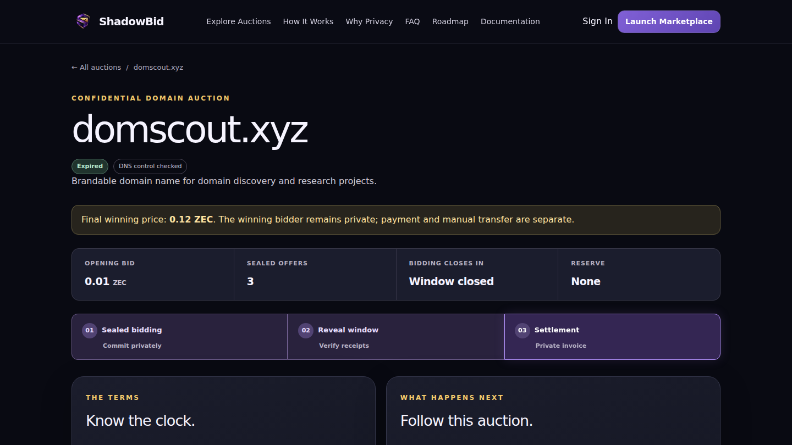
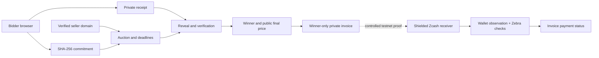
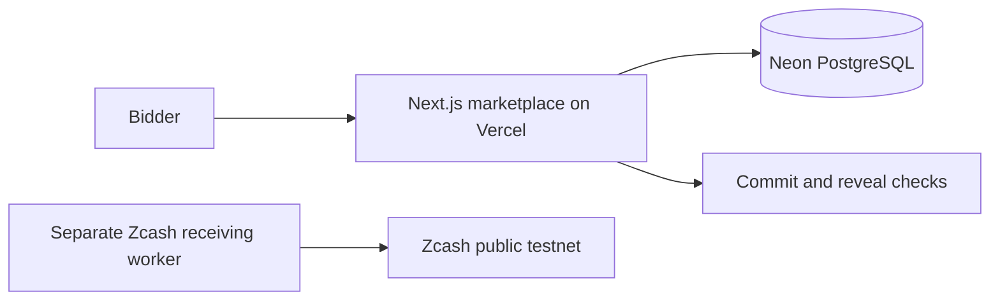

# ShadowBid

**Private auctions. Public outcomes.**

A domain name can reveal a startup's next product, a company's expansion, or an acquisition strategy. Public bidding can expose the buyer's interest and budget before a deal is made.

**ShadowBid lets domain owners accept sealed bids, verify the reveals after bidding closes, and publish the winning price without exposing every offer to other bidders.** The winning bidder gets private checkout instructions, with shielded Zcash receiving demonstrated separately on public testnet.

Built for **Zecathon 2026 — Private Markets**.

**[Live marketplace](https://shadowbid-ashy.vercel.app)** · **[Try a private auction](https://shadowbid-ashy.vercel.app/try)** · [117-second demo](https://youtu.be/K3JkEqG3q1Y) · [Judge walkthrough](docs/JUDGE_WALKTHROUGH.md) · [Zcash payment proof](docs/INVOICE_PAYMENT_PROOF.md)

[](https://youtu.be/K3JkEqG3q1Y)

## Why ShadowBid

Imagine trying to acquire a domain for a product you have not announced. An open bidding war tells competing buyers what you want and how far you may be willing to go. A conventional private negotiation conceals the offer but gives other bidders little assurance that their bids were fixed before the deadline.

ShadowBid separates the two moments:

- **Commit:** A bidder seals a hidden offer in their browser. The server receives a SHA-256 commitment, not a publicly displayed bid amount.
- **Reveal:** After bidding closes, the bidder uploads the secret receipt. The server checks that the revealed offer matches the earlier commitment.
- **Finalize:** The highest eligible revealed offer wins, using deterministic tie-break rules. The winning price becomes public; other bidders' identities and losing offers are not published.
- **Settle:** Winner-only invoice details can use a distinct Zcash shielded receiver. Payment attribution has been proven in a controlled public-testnet experiment; live Production collection remains disabled.

**The core idea:** Buyers can commit to an offer without announcing it to competitors, while sellers can close an auction under published reveal and winner-selection rules.

## Judge it yourself in four minutes

The [practice auction](https://shadowbid-ashy.vercel.app/try) uses actual commitment verification and server-enforced deadlines. **No sign-up, wallet, funds, or payable invoice is required.**

1. **Start the practice auction.** The exercise uses a reserved domain, not a real domain for sale.
2. **Seal two bids.** Keep Bidder A at **0.02 practice ZEC** and Bidder B at **0.03 practice ZEC**. Download both private JSON receipts.
3. **Wait for the reveal phase.** The server enforces two-minute bidding and two-minute reveal windows.
4. **Try tampering.** Modify the `amountZats` value in a *copy* of A's receipt. The altered receipt is rejected because it no longer matches the commitment.
5. **Reveal the originals.** Upload the unchanged A and B receipts, then observe **Bidder B win at 0.03 practice ZEC**.

Keep the original receipts private and test the altered copy **before** revealing A's valid receipt. [Exact steps and troubleshooting](docs/JUDGE_WALKTHROUGH.md).

## What has been demonstrated

| Demonstration | Result | Verify |
| --- | --- | --- |
| **Real domain auction** | `domscout.xyz`: three sealed commitments, verified eligible reveals and a published **0.12 ZEC winning price** | [Finalized auction](https://shadowbid-ashy.vercel.app/auctions/3def1e14-06e7-41a1-8d25-ebf4d3133b76) |
| **Tamper-resistant practice** | Two downloaded receipts, altered receipt rejected, valid reveals accepted, correct winner selected under server deadlines | [Judge walkthrough and recorded run](docs/JUDGE_WALKTHROUGH.md) |
| **Shielded Zcash invoice payment** | Invoice A received exactly **0.01 TAZ** on public testnet; Invoice B remained unpaid. Recipient attribution, confirmations and repeat-scan protection were verified | [Payment evidence](docs/INVOICE_PAYMENT_PROOF.md) |
| **Engineering validation** | **33 Vitest**, **29 Python**, **18 Playwright** and **13 Rust** tests passed in the recorded release review, alongside lint, TypeScript and build checks | [Release validation](docs/RELEASE_VALIDATION.md) |

The domain auction and payment test are **separate demonstrations**. The testnet payment was a wallet-controlled self-transfer, not a buyer's payment for `domscout.xyz`; no completed domain transfer is claimed.

## Why Zcash

A sealed auction and a shielded payment solve different privacy problems.

**Commit–reveal protects offers during bidding.** Each browser-generated commitment binds an offer before the reveal deadline; an altered receipt fails verification. The server verifies reveals and determines the winner, while losing offers and bidder identities remain hidden from other participants.

**Zcash protects the settlement details onchain.** A winner-specific shielded receiver lets the wallet attribute an incoming note to the correct private invoice without revealing the shielded recipient and amount to ordinary public chain observers.

The controlled public-testnet experiment confirmed:

- **0.01 TAZ / 1,000,000 zatoshis** received for Invoice A, confirmed against the active Zebra chain.
- **Invoice A: Paid; Invoice B: Unpaid**, despite distinct receivers in the same experiment.
- Matching decrypted receiver, stored payment evidence and no double credit after worker restart.
- A recorded ten-confirmation acceptance, followed by a later **584-confirmation** active-chain recheck.

**[View the exact transaction and wallet-observation proof](docs/INVOICE_PAYMENT_PROOF.md)** · [Sanitized machine-readable evidence](docs/INVOICE_PAYMENT_PROOF.json) · [Later recheck](docs/INVOICE_PAYMENT_RECHECK.json)

The public transaction ID alone does not disclose the shielded amount or recipient. Those values were established by wallet-decrypted observations and verified receiver binding.

## Built features

| Area | Implementation |
| --- | --- |
| **Domain marketplace** | Seller-created auctions, browsing, filters, watchlist and separate illustrative Demo Market |
| **Seller controls** | Domain ownership attestation through DNS TXT verification; staged CSV imports |
| **Private bidding** | SHA-256 commitments, downloadable secret receipts and server-enforced phase deadlines |
| **Deterministic results** | Reveal verification, highest eligible bid and defined tie-break rules |
| **Private checkout** | Winner-only invoice details and restricted seller settlement information |
| **Zcash receiving adapter** | Wallet-controlled shielded receiver attribution, Zebra chain checks and authenticated observation worker, tested locally and on public testnet |

The [Demo Market](https://shadowbid-ashy.vercel.app) is illustrative; its preview names are not live seller auctions.

## Architecture



**Stack:** Next.js, TypeScript, PostgreSQL/Neon, Drizzle, SHA-256 commitments, Zcash testnet, Zebra, Zallet/Zingolib and a separate authenticated receiving worker.

The web application does not host Zcash wallet keys on Vercel. The trusted operator can inspect revealed bids and operates winner selection; this is **not** a trustless escrow or automatic registrar-transfer protocol. Production payment collection is disabled. [Architecture and trust model](docs/ARCHITECTURE.md) · [Security](docs/SECURITY.md)

## Run locally

Requires Node.js **22+**, npm and PostgreSQL **16+**.

```bash
git clone https://github.com/sopskistar/shadowbid.git
cd shadowbid
npm ci
cp .env.example .env.local
# Configure a local DATABASE_URL and WORKER_SECRET in .env.local
npm run db:check
npm run db:migrate
npm run dev
```

Open [localhost:3000](http://localhost:3000). Use only a disposable development database; never point local tests or migrations at the preserved Production records. A fresh environment needs the documented configuration before seller or wallet-backed flows will work.

```bash
npm test
npm run lint
npm run build
# With a disposable loopback app/database:
E2E_ISOLATED_DB=true npm run test:e2e -- --workers=1
```

[Full setup](docs/DEPLOYMENT.md) · [Testing guide](docs/TESTING.md) · [Zcash receiver setup](docs/ZCASH_SETUP.md)

## Scope and next steps

ShadowBid demonstrates confidential domain-price discovery and a separately proven shielded-invoice receiving path. The auction operator remains trusted, domain transfers require seller/buyer action at the registrar, and mainnet production settlement is not enabled. Escrow, automated domain transfer and additional asset classes are future extensions—not current product claims.

For technical details, see the [auction protocol](docs/AUCTION_PROTOCOL.md), [privacy design](docs/PRIVACY.md), [public-testnet invoice proof](docs/INVOICE_PAYMENT_PROOF.md) and [release evidence](docs/RELEASE_VALIDATION.md).

---

## Cloud Engineering & DevOps

*Project-specific engineering evidence; only repository-supported capabilities are listed.*

### Cloud platforms
- Vercel-hosted Next.js marketplace with managed PostgreSQL on Neon and Drizzle persistence.
- The Zcash receiving worker is a separate authenticated component; key material is not deployed into the Vercel web frontend.

### DevOps & CI/CD
- Repository deployment/testing guides describe build validation and security proof workflows.
- No verified Terraform, Kubernetes, or independently evidenced production container fleet is claimed.

### Networking & API engineering
- Implements SHA-256 sealed bid commitments, deadline-checked reveal APIs and authenticated receiving-worker boundary.
- Separate Zcash public-testnet evidence; no live mainnet marketplace settlement is claimed.

### Monitoring & reliability
- Preserves public testnet receipts, auction proof and release validation artifacts.
- Operator trust and production payment limitations are explicitly disclosed; no measured uptime or backup restoration is claimed.

### Architecture & infrastructure diagram



**Deployment:** https://shadowbid-ashy.vercel.app

**Technical documentation and evidence:** [Architecture](docs/ARCHITECTURE.md) · [Deployment](docs/DEPLOYMENT.md) · [Security](docs/SECURITY.md) · [Zcash proof](docs/INVOICE_PAYMENT_PROOF.md).

**Current limits:** Zcash receiving testnet proof is distinct from marketplace settlement; Terraform and Kubernetes are not implemented here.
