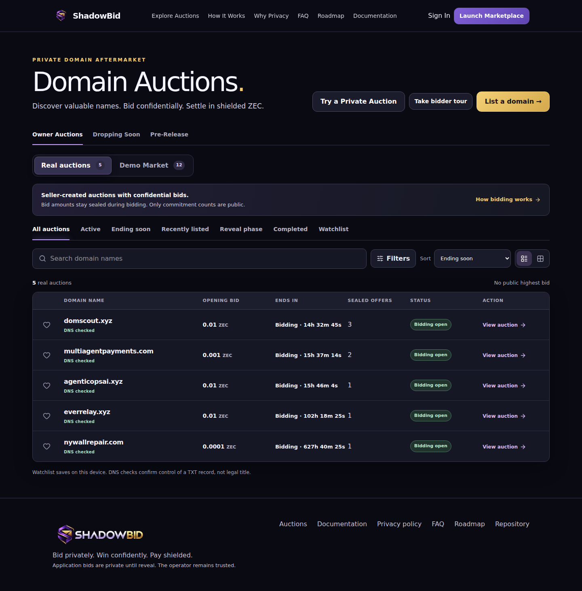
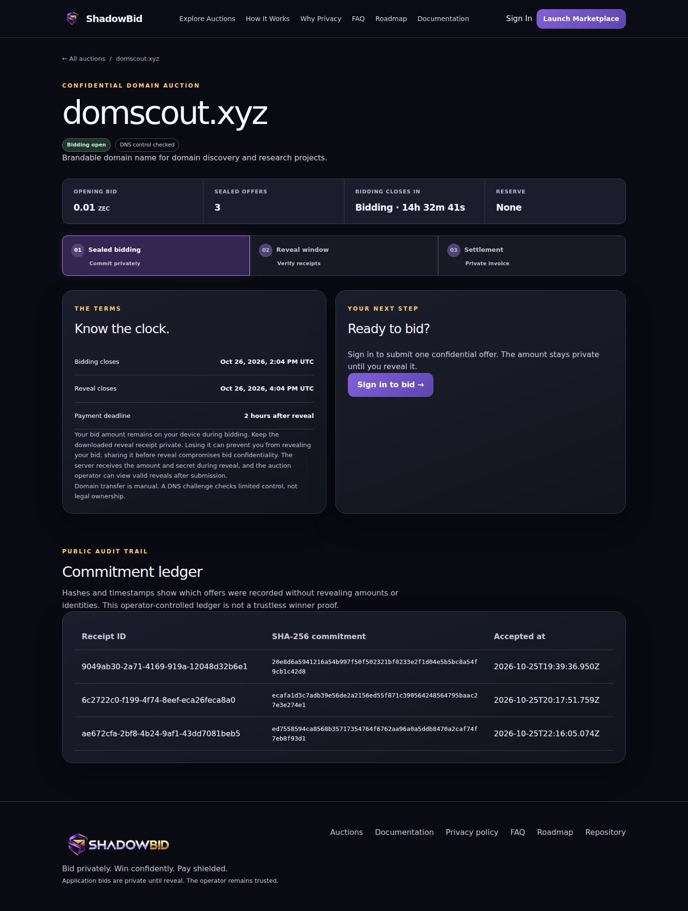
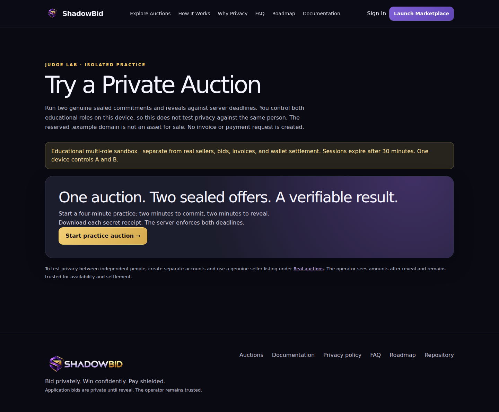

# ShadowBid demo evidence

**Submission track:** Zecathon Private Markets. ShadowBid applies sealed commitments and private reveals to owner-listed domain auctions. Bidding needs an account but no wallet or cryptocurrency. The winning account later receives an access-controlled Zcash invoice; domain transfer is manual.

**Live site:** [shadowbid-ashy.vercel.app](https://shadowbid-ashy.vercel.app) · **Four-minute judge sandbox:** [/try](https://shadowbid-ashy.vercel.app/try) · **Deployed baseline captured:** `13ba683` on 2026-10-25 UTC. The invoice checkpoint `f16a87f` was subsequently pushed and successfully deployed (GitHub Vercel status verified on 2026-10-26). DNS retry, navigation spacing, and the production payment release lock remain local pending approval. These screenshots still show the earlier baseline.

## Genuine production activity

The anonymous production `/api/auctions` response on 2026-10-25 reported five seller auctions, all with `dnsVerifiedAt` set. These are real owner listings, separate from the read-only Demo Market:

| Domain | Public sealed commitments | Phase at capture |
| --- | ---: | --- |
| domscout.xyz | 3 | Bidding open |
| multiagentpayments.com | 2 | Bidding open |
| agenticopsai.xyz | 1 | Bidding open |
| nywallrepair.com | 1 | Bidding open |
| everrelay.xyz | 1 | Bidding open |

The owner used separate authenticated bidder accounts and downloaded secret reveal receipts. The public ledger shows commitment hashes and receipt IDs without bid amounts or bidder identities. Receipt JSON files contain secrets and are **never** part of this evidence pack. Use fresh, undisclosed receipts for the final judge demonstration.

These three screenshots were captured in a fresh anonymous browser context. They contain no account data, bid amounts, reveal secrets, wallet data, or Gmail headers. No production auction had finalized at capture time, so there is **no completed-auction screenshot or public clearing price evidence yet**. Add one only after a genuine reveal and finalization. There is likewise no public-testnet payment screenshot yet.

## What the protocol demonstrates

1. A bidder commits `SHA-256(version, auction ID, bidder ID, exact integer-zatoshi amount, random secret)`. The browser downloads a **secret reveal receipt**, not a payment invoice.
2. After the bidding deadline, the bidder uploads that receipt. The server verifies the hash and records the valid reveal. Losing the receipt can prevent reveal; sharing it early compromises bid confidentiality.
3. After the reveal deadline, the highest eligible valid reveal wins. Ties use trusted commitment time, then bid ID. The final winning price is public, while the winning account and losing amounts are not. The operator can see valid reveals after submission and remains trusted to run the database and finalization.
4. The winning account sees its private payable invoice in **Payments**; the seller has a restricted settlement view, with domain, exact amount, deadline, and wallet-observed status. A shielded receiver, ZIP-321 link, copy controls, and QR appear only when a verified receiver and active monitoring are available. The user cannot mark an invoice paid.
5. Three active-chain confirmations are required before the application treats a wallet-observed payment as confirmed. Seller acknowledgment and domain transfer are separate manual attestations. ShadowBid is not escrow and does not transfer registrar ownership automatically.

The isolated [judge sandbox](JUDGE_SANDBOX.md) runs two real browser commitments, private receipts, valid and tampered reveal checks, and winner selection in about four minutes. It creates **no invoice, receiver, QR, or payment request**. Its two roles are controlled by one visitor, so it teaches the flow without claiming privacy between independent people.

## Payment evidence and limits

- **Regtest:** A genuine local Z3 shielded receiver note was recognized, cross-checked with Zebra, and reached three confirmations. The sending source was transparent coinbase and overpaid the test invoice, so this proves shielded receiving and confirmation handling, not a fully shielded sender or exact public-testnet invoice settlement. See [integration status](INTEGRATION_STATUS.md) and [testing](TESTING.md).
- **Public testnet receiver:** The isolated NU7-compatible Zingolib wallet retained control of its dedicated Unified address and scanned to Zebra's public-testnet tip. Private pre-payment observations at heights **4,541,822** and **4,541,892** showed zero notes. On 2026-10-26, the wallet decrypted a real **Ironwood** note for exactly **100,000,000 zatoshis (1 TAZ)**, txid `183df88acced845220e0394bd90937ffc4ee4c36f518f6ee876f15f26be6d03d`, output index 0, confirmed at block **4,541,930**. Zebra's `getblockhash` plus `getblock` showed the txid in that active block. A later wallet and Zebra snapshot at height **4,543,355** showed **1,426 active-chain confirmations**. A source-patched Zingolib note summary resolved the decrypted note's recipient to the existing wallet-controlled Unified address. The note's private `fauzec/v1` memo yielded a faucet request ID; Fauzec's read-only status response matched txid, height, and amount. The request ID and memo remain local. The sanitized observation is reproducible with `SHADOWBID_ZINGO_INVOICE_CLI=/path/to/patched/zingo-cli python3 scripts/receiver-observe.py`; its durable JSONL log and wallet database are gitignored and private. This faucet drip proves public-testnet shielded receiving, note recipient identification, and confirmations. It is **not an invoice payment**.
- **Production worker:** Disabled. The [Zingolib recipient adapter](ZINGOLIB_INVOICE_ADAPTER.md) identifies the real faucet note's wallet-controlled destination, and two distinct invoice receiver assignments now pass local restart and checkout checks. A real invoice-specific payment has not been demonstrated. See the [isolated experiment](INVOICE_EXPERIMENT.md). Do not infer invoice settlement from a user-provided txid, a generated address, or a simulated browser-test payment.

## Judge reproduction

1. Open the live [Owner Auctions](https://shadowbid-ashy.vercel.app/auctions) view to inspect genuine DNS-checked listings and sealed commitment counts. Public amounts remain hidden during bidding.
2. Open [/try](https://shadowbid-ashy.vercel.app/try). Start a practice auction, submit A and B within two minutes, and keep both downloaded JSON files private. Upload the receipts during the following two-minute reveal window. The result appears after the server-set deadline and explains the private invoice and manual transfer stages without asking for payment.
3. For independent-account authorization, use a fresh seller listing and two separate verified bidder accounts. Keep new receipts undisclosed. After genuine deadlines, verify one invalid reveal is rejected, valid reveals are accepted, the winning price is published without identity, and only the winning account can open its invoice. Do not change live deadlines or cancel existing commitments for a demo.
4. For a local repeat, use the disposable loopback PostgreSQL setup in [TESTING.md](TESTING.md), then run `npm run lint`, `npx tsc --noEmit`, `npm test`, `npm run test:e2e`, and `npm run build`. Browser payment fixtures are simulations. The genuine regtest script is separately gated and documented in [ZCASH_SETUP.md](ZCASH_SETUP.md).

**Email:** The owner reports that Gmail's SPF, DKIM, and DMARC checks all pass. Some verification messages still land in Spam; the site provides Inbox/Spam guidance and a rate-limited resend action. No Gmail message headers are included here.

## Validation recorded locally

On 2026-10-26 UTC, ESLint, TypeScript, all **21** Vitest unit tests, all **15** Playwright browser tests (sequential run), and the optimized production build passed. Playwright used a disposable PostgreSQL database, a loopback-only app, and the locally installed Chromium binary; its invoice payment observations are fixtures, not live-chain evidence. Anonymous production requests to `/`, `/signup`, and `/try` had returned 200 in the earlier 2026-10-25 check, and the deployed signup HTML contained the verification Inbox/Spam guidance. Authenticated production navigation was tested locally with two separate accounts and refreshes; production account credentials were not used in this evidence pass. The 2026-10-26 documentation and recipient adapter were committed and deployed in `f16a87f`; the later UX fixes remain local.

The resumed invoice experiment also passed **15** Python observer tests and a browser check of both real receiver checkouts. App and observer restart preserved the associations and unpaid state; persistent HMAC replay denial was verified after app restart. Neither invoice received a matched note. The [continuation record](INVOICE_EXPERIMENT.md) records the initial timeout failures, successful reruns, exact evidence limits, and release gate.

## Recovery review (2026-10-26)

A fresh anonymous read found eight public auctions, six DNS-verified listings, and all eight previously recorded commitments. The original five listings remain present. Relative to the prior session's snapshot, only `leadatlas.xyz` gained a DNS verification timestamp; all recorded auction deadlines and commitments were retained. Worker health was `unconfigured`. The public homepage, signup, judge sandbox, and auction list returned 200. Public styles did not contain the pending DNS retry/navigation changes.

The pending release locks worker authorization and payment instructions to explicitly configured loopback experiments. Vercel and remote database/app targets are rejected even with valid HMAC credentials. This is a code release gate until genuine invoice-specific payment, confirmations, and paid recovery have been demonstrated and production integration reviewed. No production payment activation or new chain evidence is claimed. See [recovery review](RECOVERY_REVIEW.md).
