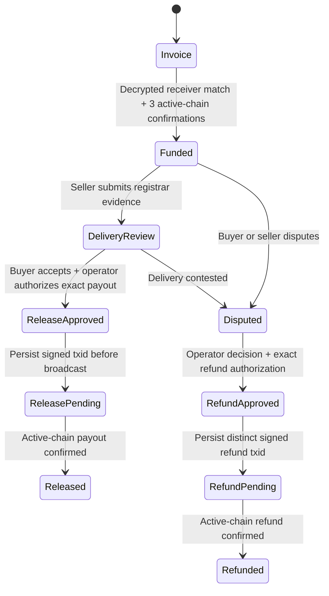

# Escrow options — researched October 27, 2026

**Recommendation: keep escrow planned for this submission.** The verified payment is a same-wallet testnet transfer. No escrow contract, buyer/seller custody separation, release, refund, or registrar delivery has been completed. The funds must not be spent under the consumed invoice-payment approval.

| Option | Compatibility and custody | Delivery, disputes and authorization | Effort and recommendation |
| --- | --- | --- | --- |
| Trusted Zcash custodian | Existing pinned Zingolib stack genuinely receives and sends shielded testnet funds. A future operator-controlled wallet could hold them; PostgreSQL alone cannot. | Buyer acceptance plus operator approval; dispute freezes release. Every payout/refund is a distinct authorized shielded transaction. Operator can steal or lose keys. | Smallest technical extension, but a real custody system is not secured by the current one-transfer script. Design only before the deadline. |
| Escrow.com sandbox | Domain transactions and a separate sandbox API are documented. Supported settlement currencies are USD, AUD, EUR, GBP and CAD; native shielded ZEC is not documented. | Provider-managed funding, inspection, acceptance/rejection/return and disbursement workflow. Private credentials and provider records remain necessary. | Useful future fiat/domain workflow; not a drop-in Zcash custodian or a testnet ZEC demonstration. |
| Registrar-assisted delivery | Account pushes or inter-registrar transfers move a domain; they do not custody ZEC. | Registrar status and buyer acceptance can support delivery review. DNS control by itself does not prove completed title/account transfer. Registrar-specific locks and account authorization apply. | Add verified manual evidence first; automate only for a selected registrar and supported TLD. |
| Zcash threshold signing | Zcash Foundation FROST tools now include merged Ironwood v6 external-signing support. This is a real shielded signing option, not proof that ShadowBid's pinned wallet can use it unchanged. | Threshold key shares, signer policy, nonce discipline, PCZT construction/proving, authenticated coordination, recovery and disputes are separate obligations. A signing quorum does not enforce domain delivery. | Highest integration cost. Not required for the trusted testnet MVP; do not introduce it before submission. |

Escrow.com documents sandbox credentials, domain-name transaction creation, and the transaction workflow. Webhook consumers should independently fetch the provider transaction before acting; a posted webhook is not sufficient payment evidence. No account, sandbox transaction, or provider integration was created. [API setup](https://www.escrow.com/api/docs), [domain transactions](https://www.escrow.com/api/docs/create-transaction), [supported currencies](https://www.escrow.com/support/faqs/what-currencies-does-escrowcom-support), [webhook verification](https://www.escrow.com/api/docs/webhooks).

Namecheap documents intra-account ownership changes and an API for incoming registrar transfers/status. Its account-push workflow requires registrar authorization and may require recipient acceptance; its published transfer API has a limited TLD list. We did not infer that an arbitrary account push can be automated through that API. [Ownership change](https://www.namecheap.com/support/knowledgebase/article.aspx/1187/46/how-can-i-move-a-domain-from-one-namecheap-account-to-another/), [transfer methods](https://www.namecheap.com/support/api/methods/domains-transfer/), [API credentials and IP allowlisting](https://www.namecheap.com/support/api/intro/).

FROST's core Rust implementation is separate from the wallet integration. The upstream Ironwood signing PR was merged August 12, 2026 and introduces v6 signature-hash and Ironwood PCZT signing paths. Dependency/API compatibility with ShadowBid's pinned Zingolib revision `4d85349f...` was **not compiled or tested**. Some fetched raw `main` content was cached older than the merged PR; the merged primary-source PR is the evidence for availability, not a claim about our installed binaries. [FROST core](https://github.com/ZcashFoundation/frost), [merged Ironwood support](https://github.com/ZcashFoundation/frost-tools/pull/593), [dependency compatibility discussion](https://github.com/ZcashFoundation/frost-tools/issues/591).

## Proposed trusted testnet MVP

Persist immutable funding-note identities, exact zatoshis, fee budget, seller receiver, buyer refund receiver, evidence hashes, authenticated acceptance, operator decision, idempotency key, signed transaction ID, broadcast-attempt marker and current chain state. Lock each custody record against concurrent release/refund; enforce release/refund mutual exclusion in a database transaction. Recheck active-chain funding before signing. A timeout after transmission leaves an uncertain attempt that must be reconciled, never replaced automatically. Reorganizations freeze completion and require review after domain delivery.

A refund cannot be sent back to an inferred shielded sender address: collect and authenticate a buyer-supplied refund receiver. Fees and amount require a new specific approval. Neither marking a row `released` nor pressing a buyer-confirmation button transfers ZEC. Until separate payout/refund integration and recovery tests pass, **safe release and refund are not verified**.
